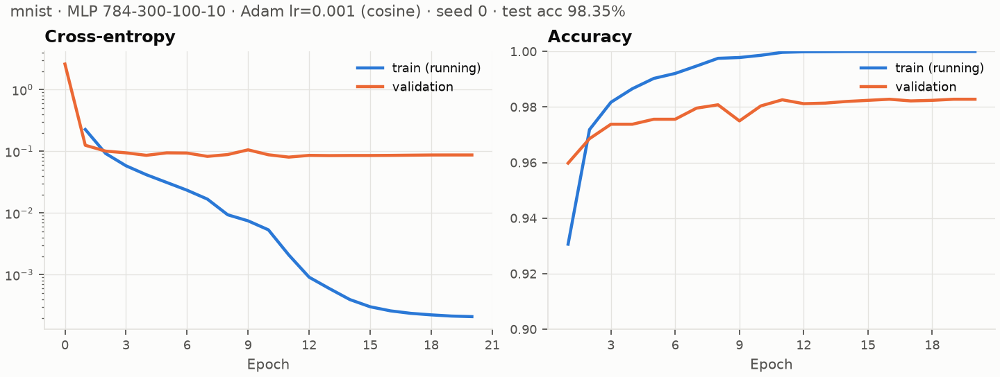

# AQUA — The Self-Pruning Network

A neural-network stack written from scratch in Python + NumPy: a reverse-mode
autodiff engine, mask-aware optimizers, and (in later parts) a classifier that
prunes its own connections during training.

No PyTorch / TensorFlow / JAX / autodiff or neural-network libraries are used.
**scikit-learn is not used at all**, not even for data loading: MNIST and
Fashion-MNIST are read from the raw IDX files by `aqua/data/datasets.py` and
verified against pinned SHA-256 checksums. Runtime dependencies are NumPy and
Matplotlib (plots only).

## Status

| Part | Scope | State |
| --- | --- | --- |
| 1 | Autodiff engine, gradient checks, masked-weight correctness | done |
| 2 | MLP, Adam, training loop | done |
| 3 | Self-pruning (importance criterion, schedule, regrowth) | — |
| 4 | Pareto sweep, cost measurement, baseline, claim | — |

## Setup

Requires Python ≥ 3.10 and [uv](https://docs.astral.sh/uv/).

```bash
uv sync
```

## Commands

| What | Command | Time |
| --- | --- | --- |
| All tests (gradient checks, masking, training) | `uv run pytest` | ~3 s |
| Gradient-check suite only | `uv run pytest tests/test_gradcheck.py` | <1 s |
| Part 2: dense MNIST training + learning curve | `uv run python scripts/train_dense.py` | ~40 s |

The first data-dependent run downloads MNIST (~11 MB) into `data/`.

Tests: finite-difference gradient checks for every operation
(`tests/test_gradcheck.py`), engine behaviour (`tests/test_engine.py`), the
masked-weight correctness suite (`tests/test_masking.py`) and layers /
initialisation / training loop (`tests/test_training.py`).

## Layout

```
aqua/
  engine/
    tensor.py      Tensor, graph construction, backward(), all core ops
    functional.py  stable log_softmax / softmax / fused cross-entropy
    parameter.py   Parameter: trainable tensor with a read-only connectivity mask
    gradcheck.py   central-difference gradient checker
  data/            MNIST / Fashion-MNIST IDX loader, synthetic spirals
  nn/              Module, Linear (reads its weight through the mask), MLP
  optim/
    optimizer.py   mask-aware optimizer base (state reset on prune/revive)
    sgd.py         SGD with momentum
    adam.py        Adam / AdamW with per-entry step counts
  train/           mini-batch loop with NaN guard, evaluation, cosine LR schedule
scripts/           experiment entry points (write to results/)
results/           committed raw numbers and plots
tests/
```

## Part 1 summary

**Operations:** `+ - * /` (with full NumPy broadcasting, including reflected
operators with Python scalars and arrays), `**` with a constant exponent,
`@` (2-D and batched with broadcast batch axes), `sum`/`mean` (any axes,
`keepdims`), `reshape`, `transpose`, `exp`, `log`, `relu`, `tanh`, `sigmoid`
(overflow-free), `gelu` (tanh approximation), `log_softmax`, `softmax`, and a
fused `cross_entropy`.

**Backward:** iterative topological sort (no recursion limit), with gradients
accumulated per node, so reused sub-expressions and broadcasting both sum
correctly. Broadcast operands get their gradient reduced back to their own shape.

**Masked weights:** see [DESIGN.md](DESIGN.md#the-gradient-of-a-masked-weight).
In short, a pruned weight has `grad == 0` exactly (the true gradient of the
function computed), `dense_grad` carries the regrowth signal, and the optimizers
keep a pruned entry's value and state at exactly zero. Optimizer state is
per-entry, including Adam's step count, so a revived connection follows the
same trajectory as a freshly initialised one. `tests/test_masking.py` checks
this against exact independent reference runs.

## Part 2 results

`scripts/train_dense.py`: LeNet-300-100 (784-300-100-10, ReLU, 266,610
parameters) on MNIST, Adam (lr 1e-3, cosine decay to 0), batch 128, 20 epochs,
seed 0. Validation is a fixed 5,000-image subset of the training set. The
official test set is only used for the final number.

| | value |
| --- | --- |
| initial validation loss | 2.598 (ln 10 = 2.303, see DESIGN.md) |
| final validation accuracy | 98.28 % |
| **test accuracy** | **98.35 %** |
| max gradient norm (any step) | 5.49 (epoch 1), 0.05 by the end |
| wall clock | ~2 s / epoch (16-core CPU, OpenBLAS) |



Raw per-epoch numbers: [`results/part2/mnist/history.json`](results/part2/mnist/history.json).
Two runs from a clean state produce identical histories. The training loop
aborts on the first non-finite loss or gradient, so a completed run is NaN-free
by construction.

Train loss reaches ~2e-4 while validation loss plateaus around 0.087: the dense
network memorises the training set. That leaves the redundancy that Part 3
prunes away.
